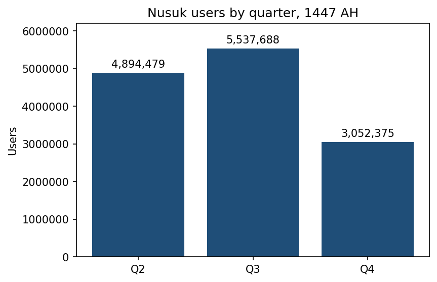
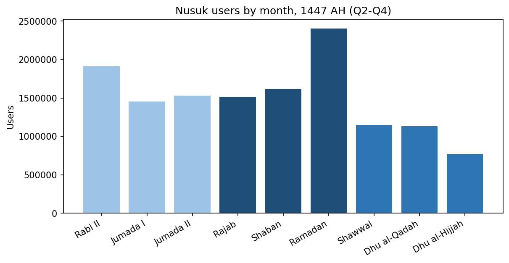
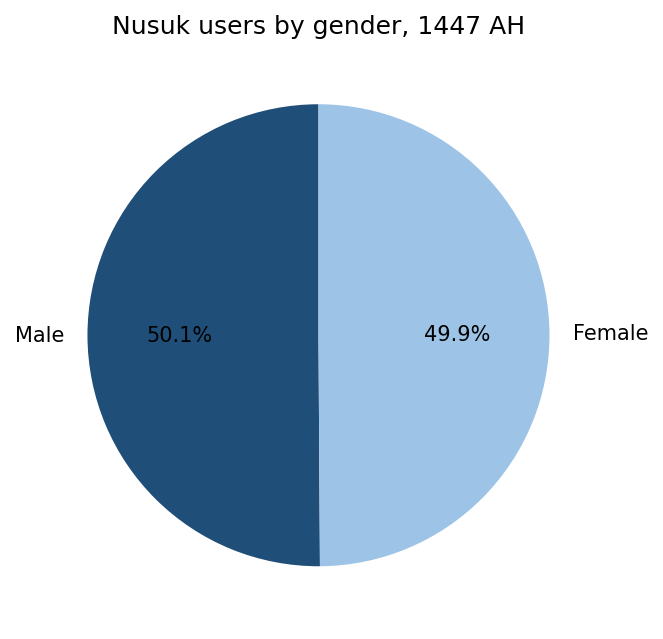

تحليل مستخدمي تطبيق نسك – 1447هـ
Nusuk App Users Analysis – 1447 AH
مشروع تحليل بيانات يعرض عدد مستخدمي تطبيق نسك لعام 1447هـ حسب الجنس والأرباع (والفئات العمرية عند توفر الملف الصحيح).
A small data-analysis project on Nusuk app users in 1447 AH, broken down by gender, quarter and (once the correct file is added) age group.
لوحة المؤشرات التفاعلية | Live dashboard: https://ra11m.github.io/nusuk-users-1447-analysis/
النتائج | Key results
الجنس | Gender
الجنس	العدد	النسبة
ذكر / Male	8,108,281	50.10%
أنثى / Female	8,075,610	49.90%
الإجمالي / Total	16,183,891	100%
الأرباع | Quarters
الربع	الأشهر	العدد	النسبة	التغير عن السابق
Q2	ربيع الآخر – جمادى الآخرة	4,894,479	36.3%	-
Q3	رجب – رمضان	5,537,688	41.1%	+13.1%
Q4	شوال – ذو الحجة	3,052,375	22.6%	-44.9%
أعلى شهر: رمضان (2,403,641). أقل شهر: ذو الحجة (772,483).
Peak month: Ramadan. Lowest month: Dhu al-Hijjah.



ملاحظات على البيانات | Data notes
الفئات العمرية غير متوفرة (خطأ في المصدر): المجموعة المنشورة على البوابة بعنوان «عدد مستخدمي تطبيق نسك حسب الفئات العمرية لعام 1447هـ» تعرض في صفحة محتوى المصدر ثلاثة صفوف فقط (السنة، ذكر 8,108,281، أنثى 8,075,610)، أي بيانات الجنس وليس الفئات العمرية. الملف المنزّل (XLSX) مطابق لملف الجنس (نفس md5). تم التحقق بتاريخ 1 نوفمبر 2026، ولذلك لم تُقدَّر أي أرقام للفئات العمرية. عند تصحيح المصدر، ضع الملف في `data/raw/users_by_age_group_1447.xlsx` وأعد تشغيل السكربت.
The portal dataset titled "Nusuk app users by age group, 1447 AH" contains gender rows only (checked 1 Nov 2026), so no age-group figures are reported.
فرق الإجماليات: مجموع الأرباع الثلاثة (13,484,542) أقل من إجمالي الجنس (16,183,891) بفرق 2,699,349. قد يعود ذلك إلى غياب الربع الأول أو إلى اختلاف التعريف (مستخدمون فريدون مقابل شهريين). تحقق من ذلك قبل المقارنة.
اسم الشهر "ربيع الثاني" في ملف الربع الثاني يُقرأ كـ "ربيع الآخر" (تعديل شكلي).
أسماء الأشهر في الرسوم بالإنجليزية لتفادي مشاكل عرض الخط العربي.
المصدر | Data source
الجهة: وزارة الحج والعمرة.
المنصة: البوابة الوطنية للبيانات المفتوحة.
المجموعات المستخدمة: مستخدمو تطبيق نسك لعام 1447هـ حسب الجنس، وحسب الربع الثاني والثالث والرابع.
تاريخ الاطلاع: 1 نوفمبر 2026.
يرجى مراجعة شروط الاستخدام والترخيص المذكورة في صفحة كل مجموعة على البوابة.
Source: Ministry of Hajj and Umrah, via the Saudi national open data portal (gender and Q2-Q4 datasets, 1447 AH). Accessed 1 Nov 2026. Check each dataset's license terms on the portal.
هيكل المشروع | Structure
```
.
├── data/
│   ├── raw/          # الملفات الأصلية (xlsx)
│   └── processed/    # جداول CSV الناتجة
├── src/analysis.py   # سكربت التحليل
├── docs/index.html   # dashboard (GitHub Pages)
├── outputs/
│   ├── charts/       # الرسوم البيانية
│   └── Nusuk_Users_1447_Analysis.xlsx   # ملف Excel بالمعادلات والرسوم
├── requirements.txt
└── LICENSE
```
التشغيل | Usage
```bash
python -m venv .venv && source .venv/bin/activate   # Windows: .venv\Scripts\activate
pip install -r requirements.txt
python src/analysis.py
```
قبل النشر على GitHub | Before publishing
البيانات منشورة على البوابة الوطنية للبيانات المفتوحة. راجع شروط الترخيص في صفحة كل مجموعة، واذكر المصدر عند إعادة النشر.
The data comes from an open data portal; check the license terms and credit the source when republishing.
الترخيص | License
MIT (انظر LICENSE).
